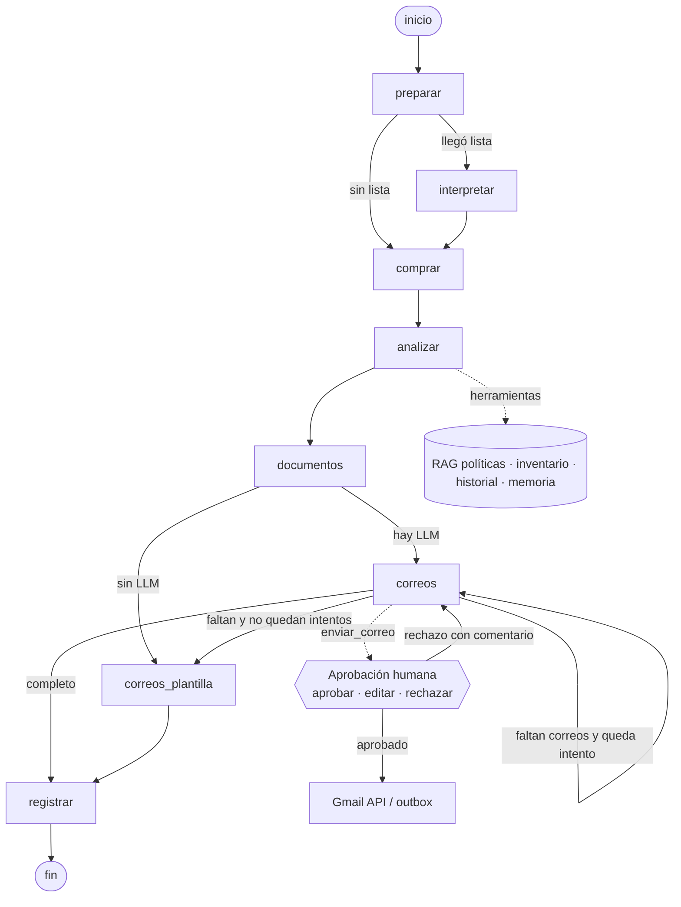
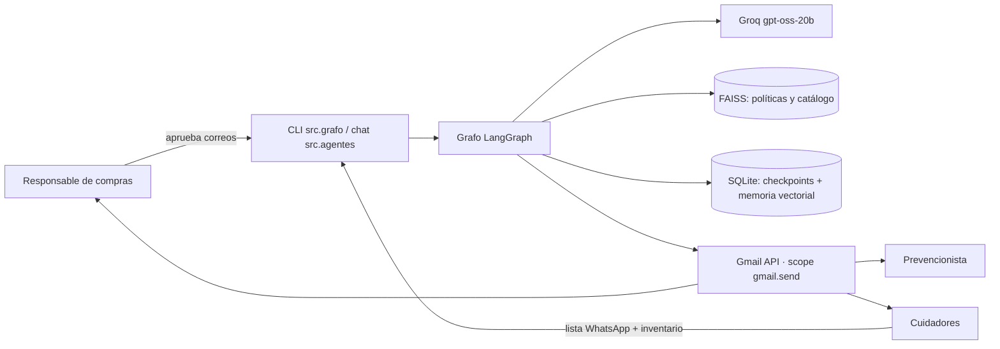

# Arquitectura del agente de abastecimiento (EP2)

Sigue la plantilla de IL2.4 del curso (`RA2/IL2.4/0-arquitectura-ra2.md`). Documenta el
sistema que procesa un relevo: de la lista de WhatsApp y el inventario del turno saliente
a la orden de compra y los correos aprobados.

## 1. Decisión de runtime (ADR)

**Contexto:** cada relevo es un proceso de varias etapas (interpretar la lista → calcular
la compra → validar presupuesto y carga → explicar → generar adjuntos → avisar por correo)
que cambia según el centro (bus o vehículo, 1 o 2 cuidadores) y la situación (sin
inventario, sobre presupuesto, sobrepeso, correo rechazado).

**Decisión:** `StateGraph` de LangGraph armado a mano, con dos agentes `create_agent`
(LangChain 1.x) como nodos. **Sin agente manager.**

**Justificación:** el orden del proceso es conocido y no depende del lenguaje natural:
no hay nada que "decidir a quién delegar". Un manager LLM agrega llamadas y un punto de
falla. En un proyecto de referencia con CrewAI jerárquico se midieron 15.000–20.000 tokens
por mensaje, y el manager razonó bien pero no siempre delegó. Aquí las rutas son
condicionales sobre datos del estado (`ruta_lista`, `ruta_correos`) y los LLM solo
trabajan donde hace falta lenguaje: explicar la orden y redactar los correos.

| Rol | Tipo | Por qué |
|---|---|---|
| Intérprete (`interpretar`) | RAG híbrido de la EP1 | El LLM solo resuelve las líneas dudosas ("algo pa la loza") |
| Comprador (`comprar`, `src/compra.py`) | Python sin LLM | Decide cantidades y montos: tiene que ser auditable y repetible |
| Analista (`analizar`, `src/agentes.py`) | Agente LLM + 7 herramientas | Consulta y razonamiento: explica la orden con la política (RAG) y la memoria |
| Correos (`correos`, `src/agentes.py`) | Agente LLM + 1 herramienta, aprobación humana | Escritura: redacta y envía por Gmail cada correo aprobado |

**Alternativas rechazadas:**

- **CrewAI con `Process.hierarchical`:** el manager reparte el trabajo con un LLM. Aquí el
  reparto es fijo, así que solo agregaría tokens y la posibilidad de que no delegue.
- **Un solo `create_agent` con todas las herramientas:** el modelo tendría que decidir el
  orden de 8 pasos y calcular montos, que es justo lo que no queremos dejarle.
- **Supervisor con `Command(goto=...)` (IL2.3):** sirve cuando el siguiente paso depende
  de interpretar texto. Aquí depende de datos (¿llegó lista? ¿quedan correos?).
- **`AgentExecutor`:** la plantilla del curso lo deja solo para leer código antiguo.

## 2. Grafo

El diagrama sale del código: `construir_grafo(...).get_graph().draw_mermaid()`.

### Vista de contexto (C4)

| Capa | En este proyecto |
|---|---|
| Presentación | `src/grafo.py` (relevo con aprobación en terminal), `src/agentes.py` (chat) |
| Aplicación | `StateGraph` (`src/grafo.py`) y dos `create_agent` (`src/agentes.py`) |
| Dominio | `src/compra.py`, `src/analisis.py`, `src/rag.py`: deterministas y con tests |
| Infraestructura | Groq, FAISS, SQLite (`.memoria/`), Gmail API (`src/correo.py`) |

## 3. Contratos

### Estado del grafo (`EstadoRelevo`)

| Campo | Lo escribe | Uso |
|---|---|---|
| `centro`, `fecha`, `texto_lista` | entrada | Identifican el relevo |
| `inventario`, `sku_anteriores` | `preparar` | Necesidad del turno y relevos consecutivos |
| `recuerdos`, `preferencias` | `preparar` | Memoria de largo plazo recuperada |
| `lista_pedida`, `lineas_revisar` | `interpretar` | Lista normalizada y líneas fuera del catálogo |
| `orden` | `comprar` | Ítems, totales, extra de mantenimiento, carga, decisiones y alertas |
| `analisis` | `analizar` | Texto del Analista (va al PDF y a los correos) |
| `carpeta`, `correos_requeridos` | `documentos` | Adjuntos y a quién hay que avisar |
| `correos`, `comentarios_revisor` (acumulativos) | `correos`, `correos_plantilla` | Registro de cada envío o rechazo |
| `intentos_correo` | `correos` | Tope de reintentos del agente de correos |
| `bitacora` (acumulativa) | todos | Qué hizo cada nodo y por qué |
| `resumen` | `registrar` | Lo que se guarda en la memoria de largo plazo |

### Memoria (IE3 e IE4)

- **Corto plazo:** `SqliteSaver` (`.memoria/checkpoints.sqlite`). El hilo es
  `thread_id = "<centro>-<fecha>"`. El estado se guarda en cada paso, incluida la pausa
  de aprobación: se puede cerrar el programa (`[s]alir`) y retomar con el mismo comando
  sin repetir el análisis. Un relevo ya cerrado no se vuelve a procesar. Con `--nuevo` se
  abre otro hilo. El chat del Analista usa el mismo checkpointer con un hilo por
  conversación ("¿y cuántos turnos rinde allá?" se entiende por la pregunta anterior).
  **Olvidar:** usar otro `thread_id` o borrar `.memoria/checkpoints.sqlite`.
- **Largo plazo (semántica):** `SqliteStore` con índice vectorial (sqlite-vec) y los
  embeddings locales del RAG. Guarda en `("relevos", centro)` un resumen por relevo y en
  `("preferencias", "correos")` cada comentario con que el revisor rechazó un correo. Se
  recupera por similitud en `preparar` y desde la herramienta `recordar_relevos`. Así, un
  comentario como "pon los kilos por persona en el asunto" se aplica en el relevo
  siguiente (`tests/test_grafo.py::test_rechazo_con_comentario...`).
  **Olvidar:** borrar `.memoria/memoria_largo_plazo.sqlite`.

### Herramientas (IE1)

| Herramienta | Agente | Entrada válida | Entrada inválida / qué pasa |
|---|---|---|---|
| `consultar_centro` | Analista | `"Tarao"`, `"Centro Tarao"`, `"Chiloé"` | Centro desconocido → error con la lista de centros |
| `consultar_inventario` | Analista | `"tarao"`, `"2026-10-09"` | Fecha sin reporte → "No hay reporte de inventario" |
| `revisar_producto` | Analista | `"detergente"`, `"maqui"` | Mantenimiento → "se compra por solicitud" |
| `historial_producto` | Analista | `"azucar"`, `"tarao"`, `6` | Producto ambiguo → toma el más parecido del catálogo |
| `buscar_politica` | Analista | Pregunta libre | Devuelve fragmentos con cita; nunca inventa |
| `recordar_relevos` | Analista | `"tarao"`, `"mantenimiento"` | Sin memoria → lo dice explícitamente |
| `calcular_orden` | Analista | `"penasmo"`, `"2026-10-07"` | Sin inventario → orden con la necesidad completa y alerta |
| `enviar_correo` | Correos | `para` de `contactos.csv`, adjuntos del relevo | Dirección fuera de `contactos.csv` → rechazado por validación; ruta con carpetas → se usa solo el nombre del archivo |

`enviar_correo` no se ejecuta sin una decisión humana (`HumanInTheLoopMiddleware`):

- **Aprobar:** se envía.
- **Editar:** se envía la versión corregida.
- **Rechazar con comentario:** el agente recibe el comentario, reescribe el correo y lo
  vuelve a proponer.
- **Descartar** (rechazo sin comentario): no se envía.

### Topes y reintentos

- `ModelCallLimitMiddleware`: máximo 6 llamadas al modelo para el Analista y 8 para
  Correos en cada ejecución.
- `ModelRetryMiddleware`: 2 reintentos con espera creciente ante `429` (cuota por minuto)
  y `400 tool_use_failed` de Groq.
- Si el Analista falla igual, el relevo sigue con un resumen sin LLM (queda en la bitácora).
- Si el agente de Correos no envía todo, hay 1 reintento con aviso explícito. Después, los
  correos que falten salen con plantillas (`correos_plantilla`), con la misma aprobación
  humana.

### Seguridad (mínimo privilegio)

- **Permiso de Gmail:** solo `gmail.send`. El agente no puede leer el buzón.
- **Destinatarios:** solo direcciones de `data/contactos.csv`. Una dirección sugerida por
  un texto malicioso se rechaza.
- **Adjuntos:** solo archivos de la carpeta del relevo. La carpeta la fija el grafo
  (`ContextoCorreos`), no el modelo.
- **Datos como datos:** los prompts indican que el texto de una lista nunca es una
  instrucción.
- **Contactos ficticios:** en modo `gmail` se redirigen a `CORREO_REDIRIGIR_A`.

## 4. Planificación y decisiones adaptativas (IE5 e IE6)

Prioridades del Comprador, en orden (política de abastecimiento):

1. Necesidad del turno menos inventario, para esenciales y normales.
2. De la lista de WhatsApp se agregan solo los opcionales que faltan y el mantenimiento
   nuevo. El mantenimiento repetido del relevo anterior se excluye y se pide confirmar.
3. El presupuesto de víveres y aseo es un tope que nunca se supera: si no alcanza, se
   recorta lo opcional y después lo normal, nunca lo esencial. El mantenimiento es
   ocasional y va como un extra aparte, que el Responsable aprueba en el correo de la orden.
4. En centros con bus, lo no esencial más pesado va en envío aparte.

**Detección de lista copiada:** se compara la lista con la compra del relevo anterior del
mismo centro (`comparar_con_relevo_anterior`). Si un 90% o más de los productos se pide
igual (mismo producto y misma cantidad), se marca como copiada. El umbral se calibró con
los 68 relevos del historial que tienen uno anterior: las 39 listas copiadas coinciden al
100% y las 29 armadas de nuevo coinciden entre 35% y 91%. Con 90% se detectan las 39 copias
y hay 2 falsas alarmas. Como la alerta no cambia la orden (solo avisa), se prefiere no dejar
pasar copias.

| Condición | Comportamiento | Evidencia |
|---|---|---|
| Llega lista de WhatsApp | Se interpreta y se contrasta: se informa el exceso evitado | `test_la_orden_sale_del_inventario_y_no_de_la_lista` |
| La lista es copia del relevo anterior (≥ 90% igual en producto y cantidad) | Alerta "Lista copiada"; se agrega por código al correo del Responsable | `test_detecta_la_lista_copiada_del_relevo_anterior`, `test_lista_copiada_llega_al_responsable_aunque_el_modelo_no_la_mencione` |
| La lista suma más que el presupuesto | Alerta "Sobregasto en la lista"; la orden se corrige a la necesidad | `test_avisa_sobregasto_de_la_lista_y_corrige_la_orden` |
| Se piden unidades sueltas ("40 rollos de confort") | Se convierten a paquetes del catálogo (4 de 12 rollos) | `test_convierte_unidades_sueltas_a_paquetes` |
| No llega lista | Se salta `interpretar`; la orden sale del inventario | caso `penasmo` en `scripts/medir.py` |
| Sin reporte de inventario | Necesidad completa y alerta | `test_sin_inventario_se_compra_la_necesidad_completa_con_alerta` |
| Víveres y aseo no caben en el presupuesto | Recorta lo opcional y después lo normal; el tope nunca se supera | `test_el_presupuesto_nunca_se_supera_y_se_recorta_lo_opcional_antes_que_lo_normal` |
| Se pide material de mantenimiento (pintura) | Va como extra, fuera del presupuesto; se pide aprobarlo en el correo de la orden | `test_el_mantenimiento_va_como_extra_fuera_del_presupuesto` |
| Mantenimiento repetido | No se compra; se pide confirmar el trabajo | `test_mantenimiento_repetido_de_una_lista_copiada_no_se_compra` |
| Centro con bus y sobrepeso | Envío aparte de lo no esencial; correo a cuidadores con kg por persona | `test_en_bus_lo_no_esencial_mas_pesado_va_aparte` |
| Centro con vehículo | Correo al prevencionista en vez de a los cuidadores | `test_correos_segun_traslado_y_mantenimiento` |
| Revisor rechaza con comentario | El agente corrige y vuelve a pedir aprobación; el comentario queda en memoria | `test_rechazo_con_comentario_el_agente_corrige_y_se_recuerda` |
| El agente no llama a la herramienta | Reintento y después plantillas | `test_si_el_agente_no_envia_se_reintenta_y_luego_plan_b` |
| Sin `GROQ_API_KEY` o cuota agotada | Resumen y correos sin LLM, con aprobación | `test_sin_llm_el_relevo_igual_se_procesa` |

## 5. Medición (IE9)

`uv run python -m scripts.medir`: relevos completos con Groq `openai/gpt-oss-20b`, todos
los correos aprobados. Corrida del 2026-10-21:

| Caso | Descripción | Llamadas LLM | Tokens entrada | Tokens salida | Segundos | Correos |
|---|---|---|---|---|---|---|
| tarao 2026-10-09 | bus, lista copiada, carga sobre el máximo | 5 | 9.957 | 901 | 26,7 | 2 |
| maqui 2026-10-15 | vehículo, lista con productos de larga duración | 5 | 8.346 | 688 | 69,4 | 2 |
| penasmo 2026-10-07 | sin lista de WhatsApp: solo inventario | 5 | 6.356 | 602 | 50,3 | 2 |

- **Costo por relevo:** menos de 11.000 tokens por relevo completo (análisis + 2
  correos). Con el límite gratuito de 200.000 tokens diarios que considera el curso,
  alcanza para unos 18 relevos al día; una ronda completa de los 5 centros son 5.
- **Tiempo:** la diferencia de segundos entre casos con las mismas 5 llamadas viene de
  la cuota por minuto de Groq. Los reintentos esperan y no fallan.
- **Elección de modelo:**
  - `gpt-oss-120b` interpretó mejor los datos en el chat, pero llamó a una herramienta
    con un nombre inventado (`revision_producto`) y Groq respondió `400 tool_use_failed`.
  - `gpt-oss-20b` no falló en el tool calling. En cambio, inventaba reglas hasta que las
    herramientas empezaron a devolver la regla con su cita. Por eso los agentes usan
    `GROQ_MODEL_TOOLS = gpt-oss-20b`.

## 6. Gmail: configuración (una sola vez)

1. En <https://console.cloud.google.com/> crea un proyecto (por ejemplo `pampasur-agente`).
2. *APIs y servicios → Biblioteca*: busca **Gmail API** y habilítala.
3. *Pantalla de consentimiento de OAuth* (Google Auth Platform): tipo **Externo**, nombre
   de la app y tu correo de soporte. En *Público / Usuarios de prueba*, agrega tu Gmail.
4. *Clientes / Credenciales → Crear cliente OAuth*: tipo **App de escritorio**. Descarga
   el JSON, renómbralo a `credentials.json` y déjalo en la raíz del proyecto (está en
   `.gitignore`).
5. Ejecuta `uv run python -m scripts.autenticar_gmail --probar tu_correo@gmail.com`. Se
   abre el navegador. Como la app está en modo prueba, Google avisa que no está
   verificada: *Continuar*. Debería llegarte un correo de prueba.
6. En `.env`: `MODO_CORREO="gmail"` y `CORREO_REDIRIGIR_A="tu_correo@gmail.com"`.

Con la app en modo prueba, Google invalida el token a los 7 días. Si el envío falla con
"token venció", repite el paso 5. Sin estos pasos, el sistema funciona igual en modo
`outbox`: los correos quedan como `.eml` en `outbox/<centro>_<fecha>/` y se abren con
cualquier cliente de correo.

## 7. Qué observará la EP3

La misma ejecución del grafo con `LANGSMITH_TRACING=true`. Se verá una traza por relevo
con los nodos, las llamadas de cada agente, los tokens y las pausas de aprobación. La
bitácora del estado ya deja registradas las decisiones que se quieren observar.
