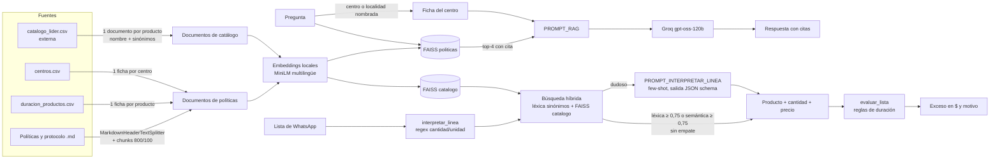

# Arquitectura del pipeline RAG (EP1)

## Fuentes de datos

| Fuente | Tipo | Archivo | Para qué se usa |
|---|---|---|---|
| Política de abastecimiento | Interna | `data/internos/politica_abastecimiento.md` | Presupuesto, extra de mantenimiento, prioridades, perecibles |
| Protocolo de relevo | Interna | `data/internos/protocolo_relevo.md` | Turnos 14x14, traslado en vehículo o bus, carga |
| Duración de productos | Interna | `data/internos/duracion_productos.csv` | Cuántos días rinde cada producto (detecta sobrecompra) |
| Centros | Interna | `data/centros.csv` | Ubicación, dotación, presupuesto, traslado |
| Catálogo Lider | Externa | `data/externos/catalogo_lider.csv` | Nombres, sinónimos y precios de productos |
| Textos externos opcionales | Externa | `data/externos/*.md`, `*.txt` | Normativa o guías que se agreguen después |

El catálogo Lider es **simulado con precios referenciales**: Lider no tiene una API
pública. El esquema del CSV permite reemplazarlo por precios reales exportados a mano.

## Flujo de información

## Componentes

| Componente | Implementación | Archivo |
|---|---|---|
| Carga y chunking | `MarkdownHeaderTextSplitter` (respeta secciones) + `RecursiveCharacterTextSplitter` (800 caracteres, 100 de solape) | `src/rag.py` |
| Embeddings | `paraphrase-multilingual-MiniLM-L12-v2`, local y normalizado | `src/config.py` |
| Vector store | FAISS con producto interno: el puntaje es la similitud coseno (0 a 1) | `src/rag.py` |
| Generación | `ChatGroq` con `openai/gpt-oss-120b`, temperatura 0 | `src/config.py` |
| Control de contexto | Cada trozo entra con su cita `[archivo > sección]`; el prompt obliga a citar y a decir "no encuentro" | `src/prompts.py` |
| Normalización de listas | Regex de cantidad + búsqueda híbrida (léxica sobre sinónimos + semántica) + LLM solo para casos dudosos | `src/rag.py` |
| Recuperación por entidad | Si la pregunta nombra un centro o su localidad, su ficha entra siempre al contexto | `src/rag.py` |
| Reglas de duración | Cálculo determinista, sin LLM | `src/analisis.py` |

## Trazabilidad

- Cada respuesta devuelve la lista de fuentes usadas (`responder()["fuentes"]`).
- Cada producto normalizado guarda la línea original, la similitud y el método que
  lo resolvió (`lexica`, `semantica`, `llm` o `revisar`).
- Los índices se reconstruyen solos cuando cambia un archivo de `data/`.

## Limitaciones conocidas

- Los precios y las duraciones marcadas como `supuesto` deben validarse con Pampasur.
- `gpt-oss` en el plan gratuito de Groq tiene un límite de tokens diario. Por eso la
  normalización usa el LLM solo cuando la búsqueda híbrida no da un resultado confiable.
- Con palabras sueltas los embeddings MiniLM se equivocan ("azucar" queda más cerca de
  "mermelada" que de "azúcar"), y con frases largas dan ~0,6 a productos equivocados.
  Por eso la búsqueda es híbrida y los umbrales dependen del origen del puntaje.
  Están calibrados en `tests/test_rag.py`; con listas reales hay que volver a medirlos.
- Groq a veces responde `400 tool_use_failed` o `json_validate_failed`. La llamada al LLM
  usa `json_schema`, reintenta 3 veces y, si igual falla, deja la línea para revisión.
